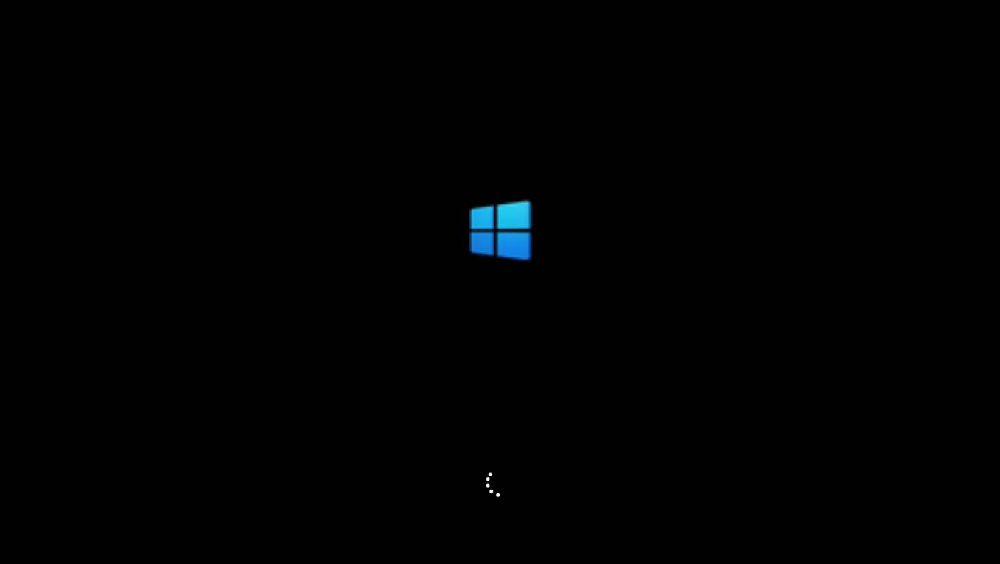
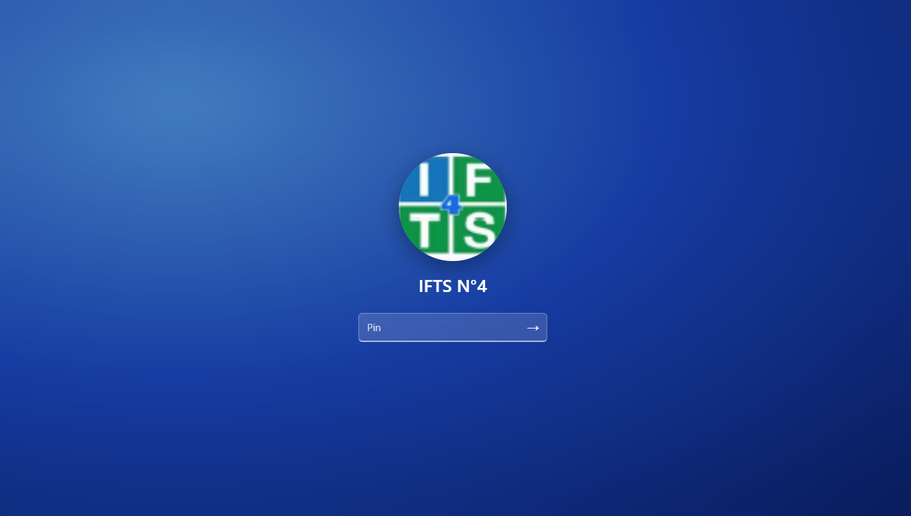
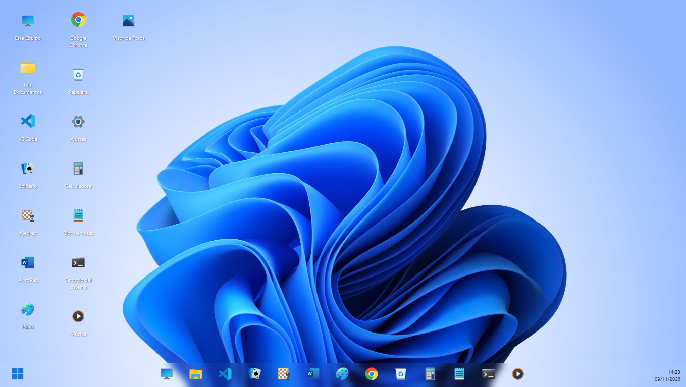
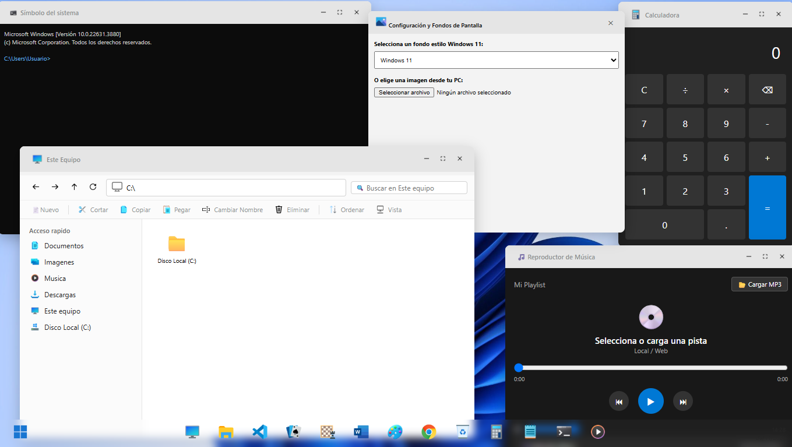
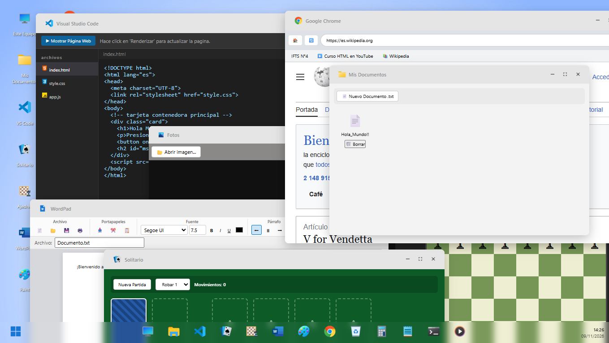
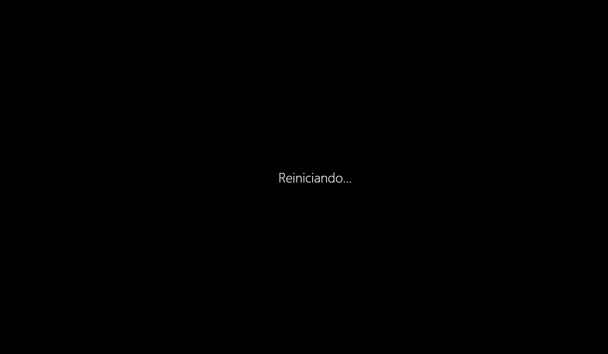
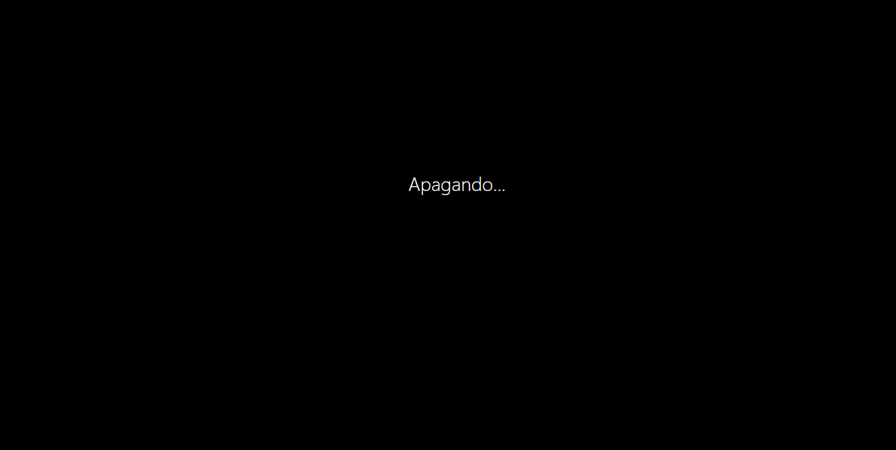
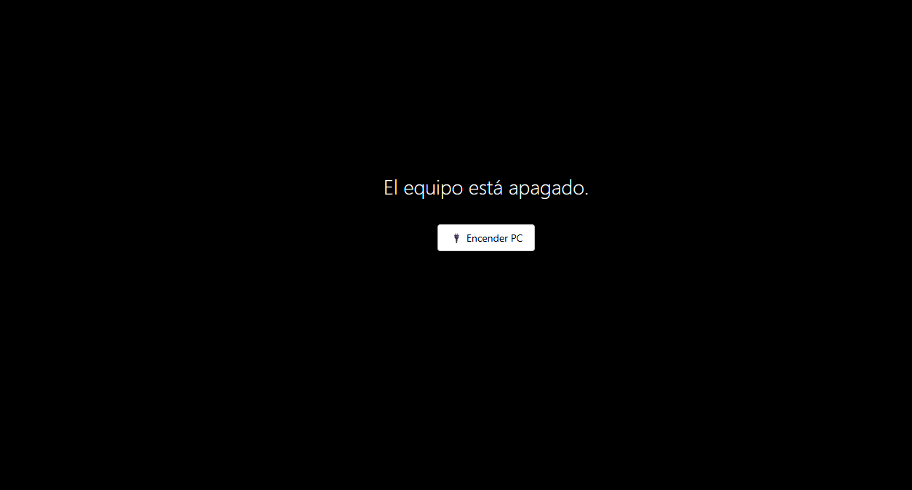
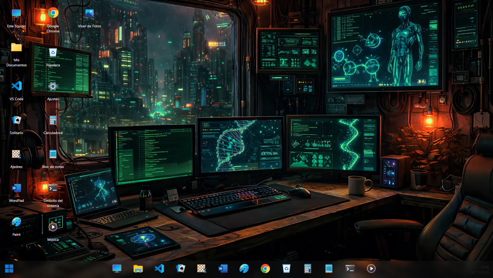

# 🪟 Windows 11 - Desktop

  

  <b>Una experiencia de escritorio completa e interactiva de Windows 11 construida puramente con tecnologías web.</b>

  
  
  

---

## 🌟 Características Principales

Tu entorno de escritorio simula con gran detalle el comportamiento clásico y moderno de un sistema operativo:

* 🖥️ **Escritorio Interactivo:** Iconos con selección doble click, menú contextual personalizado y cambio dinámico de fondos de pantalla.
* 📋 **Barra de Tareas y Menú Inicio:** Panel flotante con buscador, sección de aplicaciones fijadas y controles rápidos de energía (Apagar / Reiniciar).
* 🗂️ **Explorador de Archivos:** Navegación por carpetas (`Este Equipo`, `Mis Documentos`, `Descargas`, etc.) con barra de direcciones y cinta de opciones.
* 💻 **Visual Studio Code Integrado:** Editor funcional con pestañas para código HTML/CSS/JS y una **vista previa en vivo** renderizada al instante.
* 🎮 **Juegos Clásicos y Aplicaciones:**
  * 🃏 **Solitario** (con modos de robar 1 o 3 cartas y conteo de movimientos).
  * ♟️ **Ajedrez** totalmente jugable.
  * 🛠️ Herramientas como *Bloc de Notas, WordPad, Paint, Calculadora, Visor de Fotos, Reproductor de Música* y *Símbolo del Sistema (CMD)*.
* 🔒 **Sistema de Sesión:** Validación mediante `sessionStorage` y pantallas de apagado/encendido fluidas.

---

## 🚀 Aplicaciones y Utilidades Incluidas

| Aplicación | Icono | Descripción breve |
| :--- | :---: | :--- |
| **Este Equipo** |  | Explorador general de unidades y directorios |
| **VS Code** |  | Entorno de desarrollo con Live Preview |
| **Solitario** |  | Clásico juego de cartas de Windows |
| **Ajedrez** |  | Tablero de ajedrez interactivo |
| **Google Chrome**|  | Navegador web simulado |
| **CMD** |  | Consola de comandos del sistema |

---

## 🛠️ Tecnologías Utilizadas

* **Estructura:** HTML5 Semántico.
* **Estilos:** CSS3 Moderno (Flexbox, Grid, Animaciones y Variables de diseño Fluent Design).
* **Lógica:** JavaScript Vanilla (Manipulación del DOM, eventos de arrastre, gestión de estados y lógica de juegos).
* **Iconografía:** [Icons8](https://icons8.com/) (Estilos Fluency, 3D Fluency y Color).

---

  <h2>Capturas de Pantalla del Proyecto</h2>
  
   

  <h3>Windows 11 Iniciando</h3>
  

    

  <h3>Windows 11 Login</h3>
  

    

  <h3>Windows 11 Escritorio</h3>
  

    

  <h3>Windows 11 Aplicaciones</h3>
  

    

  <h3>Windows 11 Más Aplicaciones</h3>
  

    

  <h3>Windows 11 Reinicio</h3>
  

    

  <h3>Windows 11 Apagando</h3>
  

    

  <h3>Windows 11 Equipo Apagado</h3>
  

    

  <h3>Windows 11 Fondo Cambiado</h3>
  

 

  <!-- Banner con efecto 3D y degradado profundo -->
  

   

  <!-- Firma con icono 3D y enlace personalizado -->
  

    
    &nbsp;<b>Proyecto realizado por</b> 
    <a href="https://github.com/tu-usuario"><b>Juan Manuel Parylak</b></a>
  

